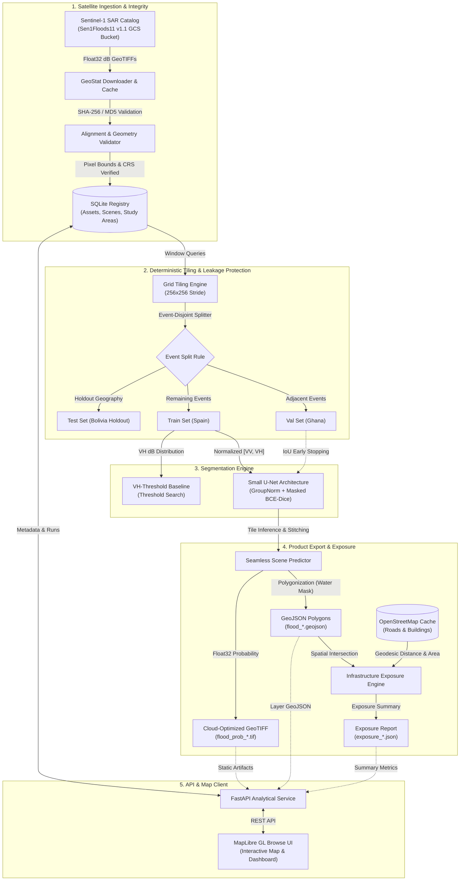
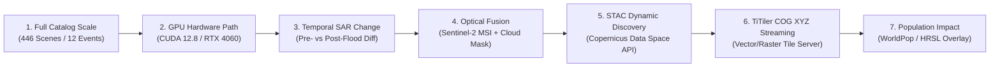

# GeoStat: Reproducible Satellite Flood Mapping & Infrastructure Exposure Platform

[](https://www.python.org/downloads/)
[](https://pytorch.org/)
[](https://fastapi.tiangolo.com)
[](https://rasterio.readthedocs.io/)
[](https://maplibre.org/)
[](https://opensource.org/licenses/MIT)

> **GeoStat** is an enterprise-grade geospatial machine learning pipeline and analytical platform designed for automated, reproducible satellite flood mapping and critical infrastructure exposure analysis. Built on Sentinel-1 C-band Synthetic Aperture Radar (SAR) imagery from the Sen1Floods11 catalog, GeoStat ingests raw dual-polarization backscatter chips, enforces strict raster alignment and SHA-256 provenance, tiles scenes into leakage-safe event-disjoint splits, trains deep segmentation models (U-Net with GroupNorm and masked BCE-Dice loss), exports Cloud-Optimized GeoTIFFs (COGs) and vector polygons, and performs geodesic intersection against OpenStreetMap roads and buildings to quantify societal impact.

---

## Architecture Overview



---

## Core Capabilities

- **All-Weather SAR Flood Mapping:** Operates on Sentinel-1 Ground Range Detected (GRD) interferometric wide-swath SAR imagery ($\text{VV}$ and $\text{VH}$ dual-polarization backscatter), penetrating cloud cover and precipitation during extreme storm events.
- **Strict Geospatial Verification & Provenance:** Enforces pixel-level affine transform, CRS (EPSG:4326), and resolution consistency between satellite acquisitions and ground-truth masks. Records SHA-256 and MD5 hashes across all raw and derived artifacts.
- **Zero-Leakage Event-Disjoint Splits:** Prevents spatial cross-contamination by isolating entire geographic flood events (countries) into dedicated training, validation, and test partitions, ensuring true out-of-distribution evaluation.
- **Deep Semantic Segmentation:** Features a custom lightweight U-Net architecture (121k parameters) utilizing `GroupNorm` (invariant to batch size fluctuations in remote sensing) and a combined masked BCE + Soft Dice loss handling severe water/land class imbalance.
- **Cloud-Optimized Product Generation:** Full-scene windowed inference with border-seam elimination, exporting float32 probability Cloud-Optimized GeoTIFFs (COGs), uint8 binary inundation masks, and simplified GeoJSON multipolygons.
- **Infrastructure Impact Assessment:** Intersects detected water boundaries with OpenStreetMap road networks and building footprints using geodesic ellipsoidal math (`pyproj.Geod` WGS84) to report flooded roadway length (km) and impacted structures.
- **Read-Only API & Static Map Console:** High-performance FastAPI analytical backend paired with a zero-build MapLibre GL frontend, providing layer toggles, real-time IoU/F1 metrics, exposure summaries, and artifact downloads.

---

## Verified Benchmark Results

All figures below are recorded from reproducible CLI executions documented in [EXPERIMENTS_AND_BENCHMARKS.md](docs/EXPERIMENTS_AND_BENCHMARKS.md) on an Intel Core i7-13620H (16 GB RAM, Windows 11):

| Stage / Experiment | Target Event / Split | Metric / Observed Fact | Hardware & Runtime |
|---|---|---|---|
| **VH Baseline Tuning** (`E-003`) | Train (`Spain`) | Optimal threshold: **-20.50 dB** (Train IoU: 0.7528) | CPU, < 1s |
| **U-Net Training** (`E-004`) | 16 Tiles ($256\times256$) | Loss: $0.5497 \to 0.4747$, 121,105 parameters | 4 CPU threads, 2.5s (5 epochs) |
| **Holdout Evaluation** (`E-005`) | Test (`Bolivia`, 325k px) | **IoU: 0.6302** · **F1: 0.7732** · Prec: 0.7636 · Rec: 0.7830 | CPU, 1.2s |
| **Scene Analysis** (`E-006`) | Scene `Bolivia_103757` | **IoU: 0.5293** · **F1: 0.6922** · 55,141 flooded px · 2,491 polygons | CPU, 1.8s |
| **Exposure Analysis** (`E-007`) | Scene `Bolivia_103757` | Roads: 0.000 / 0.000 km · Buildings: 0 / 0 (Remote wetland) | Overpass/OSM cache, < 1s |

---

## Project Structure

```text
geostat/
├── configs/                       # Versioned pipeline execution configs
│   ├── split_event_holdout.json   # Event-disjoint partition configuration
│   └── unet_small.json            # U-Net hyperparameters & training config
├── docs/                          # Architectural documentation & engineering journal
│   ├── DOCUMENTING.md             # Engineering journal & single source of truth
│   ├── ARCHITECTURE.md            # System topology & data lifecycle
│   ├── EXPERIMENTS_AND_BENCHMARKS.md # Append-only verified benchmark records
│   ├── GEO_PIPELINE.md            # Radar pre-processing & tiling formulas
│   ├── MODEL_CARD.md              # Model architecture, training data & ethical limits
│   ├── DATABASE_SCHEMA.md         # SQLite relational schema & indexes
│   ├── API_SPECIFICATION.md       # OpenAPI / REST endpoint specifications
│   ├── DEPLOYMENT.md              # Analyst workstation setup & runbooks
│   ├── TESTING_STRATEGY.md        # Test suite matrix & verification gates
│   ├── SECURITY.md                # Threat model & safe file-serving boundaries
│   ├── CHANGELOG.md               # Versioned milestone history
│   └── decisions/                 # Architecture Decision Records (ADR-001 - ADR-007)
├── frontend/                      # Static MapLibre GL web client
│   ├── index.html                 # Single-page console layout
│   ├── app.js                     # MapLibre map controllers & layer sync
│   ├── styles.css                 # Clean analytical UI styling
│   └── vendor/                    # Vendored MapLibre GL JS & CSS
├── src/
│   └── geostat/                   # Core Python package
│       ├── api.py                 # FastAPI service & artifact endpoints
│       ├── baseline.py            # Radiometric threshold baseline & search
│       ├── cli.py                 # Unified pipeline CLI interface
│       ├── dataset.py             # PyTorch windowed GeoTIFF Dataset loader
│       ├── db.py                  # SQLite storage layer, migrations & runs
│       ├── download.py            # Official GCS Sen1Floods11 fetcher
│       ├── exposure.py            # OSM infrastructure extraction & geodesic math
│       ├── geoio.py               # Rasterio raster I/O, alignment & geometry
│       ├── inference.py           # Seamless window stitching & COG export
│       ├── ingest.py              # Chip cataloging & relational registration
│       ├── metrics.py             # Geospatial confusion matrix, IoU, and F1
│       ├── provenance.py          # Environment, hardware & SHA-256 telemetry
│       ├── settings.py            # Central environment paths & constants
│       ├── tiling.py              # Grid slicing & split disjointness checks
│       ├── train.py               # PyTorch training loop & early stopping
│       └── unet.py                # SmallUNet architecture & masked BCE-Dice loss
├── tests/                         # Comprehensive automated test suite
│   ├── conftest.py                # Synthetic GeoTIFF fixtures & seeds
│   ├── test_api.py                # FastAPI route contracts & responses
│   ├── test_baseline.py           # Threshold search & train-only guard tests
│   ├── test_exposure.py           # OSM parser & geodesic summary unit tests
│   ├── test_geoio.py              # Affine transforms, metadata & alignment tests
│   ├── test_inference.py          # Window stitching & prob bounds tests
│   ├── test_metrics.py            # Confusion matrix & nodata exclusion tests
│   ├── test_security.py           # Path traversal & unauthorized file checks
│   ├── test_tiling.py             # Disjoint split & manifest SHA stability tests
│   └── test_unet.py               # Model gradients, parameter count & loss tests
├── artifacts/                     # Generated run artifacts (manifests, models, COGs)
├── data/                          # Raw, reference, cache & SQLite storage
├── pyproject.toml                 # Package dependencies & hatchling build config
└── README.md                      # This file
```

---

## Quickstart

### 1. Prerequisites & Environment Setup

GeoStat uses modern Python packaging via `uv` or standard virtual environments:

```powershell
# Clone and enter directory
cd "C:\Users\Abhi\Desktop\resume projects\geostat"

# Create and activate Python 3.12 virtual environment
uv venv --python 3.12 .venv
.\.venv\Scripts\activate

# Install editable package with dev & test dependencies
uv pip install -e ".[dev]"

# Verify environment, raster stack, and code revision
python -m geostat.cli env
```

---

### 2. End-to-End Pipeline Execution

Run the complete pipeline from reference download to interactive map serving:

```powershell
# 1. Download reference split CSVs and official GeoJSON metadata
python -m geostat.cli download-reference

# 2. Download sample chips (or '--mode all' for the complete 700 MB catalog)
python -m geostat.cli download --mode sample

# 3. Initialize SQLite relational database schema
python -m geostat.cli init-db

# 4. Ingest and validate downloaded Sentinel-1 & label rasters
python -m geostat.cli ingest --sample

# 5. Build deterministic, event-disjoint tile manifest
python -m geostat.cli manifest --config configs/split_event_holdout.json

# 6. Fit and evaluate the radiometric VH threshold baseline
python -m geostat.cli baseline --manifest artifacts/manifests/split_event_holdout.json

# 7. Train the lightweight U-Net neural network
python -m geostat.cli train --config configs/unet_small.json

# 8. Evaluate trained model on out-of-sample holdout event
python -m geostat.cli eval --run <train-run-id> --split test

# 9. Perform full-scene inference and export COGs + GeoJSON polygons
python -m geostat.cli analyze --scene Bolivia_103757 --run <train-run-id>

# 10. Compute infrastructure exposure against OpenStreetMap
python -m geostat.cli exposure --scene Bolivia_103757

# 11. Launch API and MapLibre visual interface
python -m geostat.cli serve --port 8787
```

Once running, navigate to:
- **Interactive Map Console:** [http://127.0.0.1:8787](http://127.0.0.1:8787)
- **FastAPI OpenAPI Swagger:** [http://127.0.0.1:8787/api/docs](http://127.0.0.1:8787/api/docs)

---

## Testing & Quality Assurance

GeoStat maintains a strict, unit-isolated test suite utilizing synthetic GeoTIFF fixtures to verify mathematical and geometrical invariants without network dependencies:

```powershell
# Run the complete test suite
pytest -v

# Run with coverage report
pytest --cov=geostat tests/

# Quiet execution
pytest -q
```

**Test Coverage Summary:**
- `test_geoio.py`: Affine transform inversion, resolution scale, and coordinate alignment verification.
- `test_tiling.py`: Event-disjoint partition enforcement and manifest byte-determinism.
- `test_metrics.py`: Accurate masking of $-1$ nodata pixels and zero-division resilience.
- `test_unet.py`: SmallUNet backpropagation, parameter counts, and mixed BCE-Dice loss.
- `test_inference.py`: Full-scene window reconstitution without edge artifacts.
- `test_exposure.py`: Pyproj ellipsoidal distance and polygon area intersection.
- `test_api.py`: FastAPI endpoints, error handling, and frontend mounting.
- `test_security.py`: Protection against directory traversal (`../`) on artifact routes.

---

## What's Next: High-Impact Engineering Roadmap

For production scaling and advanced geospatial intelligence, the next planned feature increments are:



1. **Full Catalog Scale-Up (`geostat download --mode all`)**: Ingest all 446 Sentinel-1 scenes across all 12 global flood events, expanding the training corpus from the 4-chip sample to the full 700 MB benchmark.
2. **GPU Acceleration Path (CUDA 12.8 / DirectML)**: Activate NVIDIA RTX 4060 Laptop GPU acceleration for 50+ epoch training runs, cosine annealing with warm restarts, and sub-100ms full-scene tile batch inference.
3. **Multi-Temporal Change Detection (Pre- vs Post-Flood)**: Ingest pre-disaster baseline acquisitions to isolate permanent water bodies (rivers, lakes, wetlands) from transient flood inundation via differential backscatter ($\Delta\sigma^0$).
4. **Multispectral Fusion (Sentinel-2 Optical)**: Ingest coincident Sentinel-2 Level-2A imagery when cloud cover allows, calculating MNDWI (Modified Normalized Difference Water Index) to cross-validate radar detections.
5. **Live STAC Discovery (Copernicus Data Space API)**: Transition from static Sen1Floods11 bucket downloads to dynamic SpatioTemporal Asset Catalog (STAC) queries, fetching real-time Sentinel-1 GRD acquisitions for newly declared disaster areas.
6. **Dynamic COG Tiling via TiTiler & PostGIS**: Implement a TiTiler dynamic tile server with PostGIS integration, streaming Cloud-Optimized GeoTIFF XYZ tiles directly to MapLibre GL to handle continental-scale inundation rasters without client-side GeoJSON memory bottlenecks.
7. **Human Settlement & Vulnerability Layer**: Integrate High-Resolution Settlement Layer (HRSL) and WorldPop datasets to automatically compute estimated affected population counts and economic exposure indices.

---

## Documentation Index

- [Engineering Journal & Status Table](docs/DOCUMENTING.md)
- [System Architecture & Module Design](docs/ARCHITECTURE.md)
- [Append-Only Benchmark & Experiment Log](docs/EXPERIMENTS_AND_BENCHMARKS.md)
- [Geospatial Radar Pipeline & Tiling Rules](docs/GEO_PIPELINE.md)
- [Model Card & Safety Boundaries](docs/MODEL_CARD.md)
- [SQLite Relational Schema & Indices](docs/DATABASE_SCHEMA.md)
- [REST API OpenAPI Specification](docs/API_SPECIFICATION.md)
- [Single-Analyst Deployment Guide](docs/DEPLOYMENT.md)
- [Testing Matrix & Verification Rules](docs/TESTING_STRATEGY.md)
- [Threat Model & Security Safeguards](docs/SECURITY.md)
- [Architecture Decision Records (ADRs)](docs/decisions/)

---

## License & Attribution

- **Code:** Licensed under the [MIT License](LICENSE).
- **Satellite Data:** Sen1Floods11 v1.1 dataset &copy; Cloud to Street (PBC), 2020. Citation: Bonafilia, Tellman, Anderson, Issenberg, *Sen1Floods11: A Georeferenced Dataset to Train and Test Deep Learning Flood Algorithms for Sentinel-1*, CVPR-W 2020.
- **Infrastructure Data:** OpenStreetMap data &copy; OpenStreetMap contributors, licensed under the Open Database License ([ODbL 1.0](https://opendatacommons.org/licenses/odbl/1-0/)).
- **Disclaimer:** GeoStat is an analytical research prototype. Predicted water extent layers are segmented surface inundations, not calibrated operational flood hazard forecasts.
