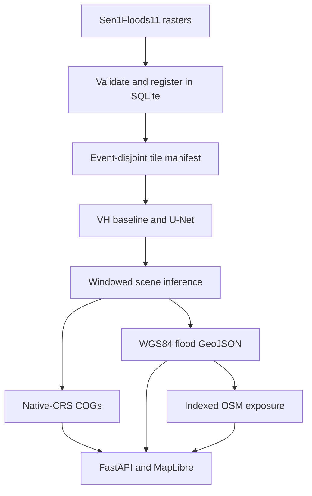

# GeoStat

GeoStat maps floodwater from Sentinel-1 SAR imagery and estimates which OpenStreetMap roads and buildings intersect the mapped water. It uses the Sen1Floods11 hand-labeled dataset for training and evaluation. The CLI builds reproducible products, and the FastAPI service exposes a map and derived layers.

## Pipeline



Raster reads, masks and vector export live in `geostat.geoio`. CRS transforms, the Shapely STRtree and WGS84 measurements live in `geostat.spatial`. The CLI, API, and OSM integration share those primitives. The SQLite registry tracks data hashes, model checkpoints, configuration, run status and artifact paths.

## Quickstart

Install [uv](https://docs.astral.sh/uv/getting-started/installation/) and use Python 3.12 or 3.13. The commands below use the locked CPU environment. Downloads and uncached OSM lookups require network access.

```bash
git clone https://github.com/yuno7777/geostat.git
cd geostat
uv sync --locked --extra dev --python 3.12
uv run geostat env
uv run geostat init-db
uv run geostat download-reference
uv run geostat download --mode sample
uv run geostat ingest --sample
uv run geostat manifest --config configs/split_event_holdout.json
uv run geostat baseline --manifest artifacts/manifests/split_event_holdout.json
uv run geostat train --config configs/unet_small.json
```

The train command prints a model ID. Remove its `unet-opt-` prefix and paste the resulting `train-…` run ID below.

```bash
TRAIN_RUN='train-REPLACE_WITH_YOUR_RUN_ID'
uv run geostat eval --run "$TRAIN_RUN" --split test
uv run geostat analyze --run "$TRAIN_RUN" --scene Bolivia_103757
uv run geostat exposure --scene Bolivia_103757
uv run geostat serve
```

Open [the map](http://127.0.0.1:8787/) or [the OpenAPI docs](http://127.0.0.1:8787/api/docs). To see the configured storage locations, run `uv run geostat env`. Set `GEOSTAT_DATA_DIR` and `GEOSTAT_ARTIFACTS_DIR` before starting GeoStat to use other locations.

```bash
curl --fail http://127.0.0.1:8787/api/scenes/Bolivia_103757
curl --fail http://127.0.0.1:8787/api/layers/flood/Bolivia_103757
curl --fail http://127.0.0.1:8787/api/exposure/Bolivia_103757
```

The same exposure calculation can run without the API, data downloads, or a model.

```python
from shapely.geometry import LineString, box

from geostat.exposure import exposure_summary

flood = box(72.85, 19.07, 72.86, 19.08)
road = LineString([(72.84, 19.075), (72.87, 19.075)])
result = exposure_summary(
    [flood],
    [{"id": "road-1", "highway": "primary", "geometry": road}],
    [],
)
print(result["roads"]["flooded_m"])
```

## Spatial conventions and scale

- Rasters require a declared CRS and matching grids for pixelwise comparison. COGs keep their native CRS. GeoJSON exports use longitude, latitude in WGS84, with antimeridian polygons cut at the seam. Projected edges are sampled during conversion.
- GDAL masks and raster nodata are applied before normalization. A pixel with neither SAR band available is invalid. Inference writes NaN in the float32 probability product and 255 in the uint8 mask. Border tiles are padded for the U-Net and cropped to the raster extent.
- Exposure clips straight segments in a locally unwrapped longitude/latitude frame and measures clipped lengths and areas on the WGS84 ellipsoid. Geodesic measurement supports high latitudes. Polygon overlay assumes a local scene within a longitude span under 180° and rejects pole-enclosing or global flood polygons. OSM roads are measured over the fetched ways and may extend beyond the scene bounds. OSM relation geometries are outside the current way-based parser.
- Raster scans and model input windows use bounded reads. CLI scene export writes predictions and masks by window and streams GeoJSON from a complete on-disk wet mask. GDAL polygonization can still use substantial memory for complex boundaries. The Python array API retains both whole-scene arrays. Overlay indexes flood polygons and dissolves intersecting candidates locally to avoid double-counting flood overlap.
- Re-run `analyze` for older outputs generated from projected rasters and run `exposure --refresh` afterward. The existing SQLite schema and WGS84 cache files remain readable.

## Benchmarks

Run from the checkout on Linux or macOS.

```bash
uv run --locked --extra dev python scripts/benchmark_spatial.py --repeats 3
```

Measured on AMD EPYC 7763, Linux x86-64, Python 3.12.14, NumPy 2.2.6, Rasterio 1.4.4 / GDAL 3.10.3, Shapely 2.2.0 / GEOS 3.14.1, pyproj 3.8.0. Each trial used a fresh process and seeded synthetic inputs. Time is the median of three trials after fixture creation. Peak RSS is the highest across those trials and includes imports, fixture creation, and native libraries. Raster trials use compressed two-band float32 GeoTIFFs and a 16 MiB GDAL cache.

| Workload | Size | Median time | Peak RSS |
|---|---|---:|---:|
| Indexed exposure | 100 polygons, 1,000 roads/buildings | 0.0586 s | 67.9 MiB |
| Indexed exposure | 1,000 polygons, 10,000 roads/buildings | 0.5980 s | 73.3 MiB |
| Indexed exposure | 10,000 polygons, 100,000 roads/buildings | 6.2727 s | 127.2 MiB |
| Windowed / full-array raster scan | 512 × 512 | 0.0128 / 0.0129 s | 93.3 / 93.2 MiB |
| Windowed / full-array raster scan | 2,048 × 2,048 | 0.1790 / 0.3519 s | 107.2 / 211.4 MiB |
| Windowed / full-array raster scan | 4,096 × 4,096 | 0.6863 / 1.5377 s | 107.1 / 547.5 MiB |

Both raster scan methods returned a nodata fraction of 0.125 at all three sizes. See [the original experiments](docs/EXPERIMENTS_AND_BENCHMARKS.md) for historical model training and evaluation results.

## Checks

```bash
uv run --locked --extra dev ruff check .
uv run --locked --extra dev ruff format --check .
uv run --locked --extra dev mypy
uv run --locked --extra dev pytest
```

CI runs these checks plus a CLI smoke test on Python 3.12 and 3.13 on Windows and Linux for pushes and pull requests. The test suite builds synthetic rasters and a temporary SQLite registry.

### Real-data smoke test

The separate CI smoke job processes the `Spain_7387658` Sen1Floods11 scene end to end. It pins both public TIFFs by GCS generation, file size and SHA-256, and uses three recorded OpenStreetMap ways for exposure. The deterministic test checkpoint produces a known mask to verify the two COGs, the GeoJSON round trip and the API. It does not measure model accuracy.

```bash
GEOSTAT_REAL_DATA_SMOKE=1 uv run --locked --extra dev pytest tests/test_real_data_smoke.py
```

In PowerShell, set `$env:GEOSTAT_REAL_DATA_SMOKE = "1"` before running the same pytest command.

An optional `GEOSTAT_SMOKE_DATA_DIR` points to a local directory containing the original TIFF filenames. Both files are verified against the same pins in either mode.

See the [Windows and Linux roadmap](docs/ROADMAP.md) for milestones and acceptance checks.

## Attribution

Sen1Floods11 is credited to Bonafilia, Tellman, Anderson and Issenberg. Infrastructure data © OpenStreetMap contributors, available under the [Open Database License](https://www.openstreetmap.org/copyright). See the [data catalog](docs/DATA_CATALOG.md) for dataset attribution and the [API specification](docs/API_SPECIFICATION.md) for routes.
